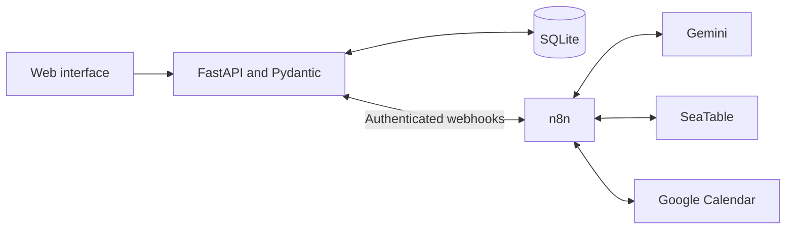

# Flowdesk

### Lead qualification and appointment automation

Flowdesk connects customer inquiries to a CRM and a live appointment calendar. It combines a FastAPI backend, persistent local storage and credential-backed n8n workflows in one web application.

**Python · FastAPI · Pydantic · SQLite · n8n · Gemini · SeaTable · Google Calendar**

## Features

### Lead qualification

- Capture inquiries with contact validation and explicit consent.
- Classify and summarize inquiries using Gemini, including missing information.
- Validate model output against a Pydantic schema before CRM delivery.
- Save inquiries locally before calling external services.
- Search SeaTable by a stable lead reference to prevent duplicate delivery on retry.
- Cache validated analysis so CRM retries do not repeat successful model processing.

### Appointment management

- Check Google Calendar free/busy for a future appointment slot.
- Reserve slots locally before attempting external creation.
- Reuse the same event ID when recovering an uncertain booking.
- Read the event back before issuing a booking confirmation.
- Verify pending reservations and cancel existing appointments.
- Reject conflicting local reservations and invalid dates or times.

Appointments last one hour, with start times from **10:00 to 15:00, Asia/Dubai (UTC+4)**.

## Architecture



The backend owns validation, persistent state and confirmation rules. n8n owns authenticated calls to the external services. Model-generated text does not authorize appointments; confirmation depends on Calendar readback.

## Getting started

### Requirements

- Python 3.12 or newer and `uv`
- Docker Desktop with a configured n8n instance
- Gemini API access, a SeaTable base and Google Calendar OAuth credentials

### Run the application

```powershell
git clone https://github.com/NotShabz2004/flowdesk-ai-workflows.git
cd flowdesk-ai-workflows
uv sync
Copy-Item .env.example .env
```

Configure the connections below, then start the backend:

```powershell
uv run uvicorn main:app --host 127.0.0.1 --port 18766
```

- **Application:** http://127.0.0.1:18766
- **API documentation:** http://127.0.0.1:18766/docs
- **Expected local n8n editor:** http://localhost:5679

On Windows, `Start.cmd` runs the backend after dependencies and connections are configured.

### Configure n8n and external services

1. Import `live-workflows.json` into n8n. The six exported workflows are inactive until configured.
2. Select your own Gemini, SeaTable and Google Calendar credentials in the imported nodes. Credential references in the exports are instance-specific; secrets are not included.
3. Create a Header Auth credential with header name `X-Portfolio-Key`. Set a long random value and select it on each webhook trigger. Set that same value as `N8N_CONNECTOR_SECRET` in `.env`.
4. Create the SeaTable columns listed below.
5. Set your calendar ID in `integrations.py` and `build_integrations.py`. Regenerate the service exports with `uv run python build_integrations.py`, and import the regenerated workflows before activation. The CRM workflow is exported separately as `portfolio-crm.json`.
6. Activate the configured service workflows. Keep their webhook paths as `portfolio-ai`, `portfolio-crm` and `portfolio-calendar-*`.

The default webhook base URL is `http://127.0.0.1:5679/webhook`. Override it with the `N8N_WEBHOOK_BASE_URL` environment variable when needed. The connector secret can also be supplied as an environment variable.

**SeaTable schema:** table `Table1`, with these columns, all of type **Text**:

| Column | Purpose |
| --- | --- |
| Name | Customer name |
| Lead ID | Stable reference used for duplicate detection |
| Contact | Email address or phone number |
| Inquiry | Original inquiry text |
| Category | Validated inquiry classification |
| Summary | Validated inquiry summary |
| Status | Qualification or clarification status |

Provider availability and quotas may affect requests. The Gemini model is configured in `build_integrations.py`. Provider credentials stay in n8n; the connector secret is never sent to the frontend.

## API overview

| Method | Endpoint | Purpose |
| --- | --- | --- |
| `POST` | `/api/leads` | Save, analyze and deliver an inquiry |
| `GET` | `/api/leads` | List locally saved leads and analysis |
| `GET` | `/api/availability` | Check a date and slot |
| `POST` | `/api/bookings` | Create and verify an appointment |
| `GET` | `/api/bookings` | List local reservations |
| `POST` | `/api/bookings/{id}/verify` | Verify a Calendar event |
| `DELETE` | `/api/bookings/{id}` | Cancel and release a reservation |

See `/docs` for request schemas and interactive examples. Earlier mock endpoints remain for isolated regression tests; the frontend uses `/api/*`.

## Reliability and recovery

**Inquiry delivery:** a failed external call leaves the original inquiry in SQLite. Repeating the same contact and inquiry reuses its lead reference. Validated analysis is cached, and the CRM workflow searches for an existing row before creating one.

**Booking confirmation:** a missing response is treated as an uncertain outcome. The reservation remains pending until verified or recovered. A successful Calendar creation response alone is insufficient; the backend reads the event back before confirming it.

**Cancellation:** the local reservation is released after Calendar cancellation, or an authoritative response establishing that the event is already absent. A missing n8n webhook is not treated as a missing Calendar event.

## Testing

### Automated tests

```powershell
uv run pytest -q test_workflows.py test_integrations.py
```

The recorded test run passed **22 tests**, covering consent, input validation, duplicate handling, concurrent local requests, invalid model output, booking conflicts, lost responses and recovery. Tests use temporary databases and mocked external services.

### Live integration checks

```powershell
uv run python verify_live.py
```

This opt-in script calls the configured real services. It creates a synthetic CRM lead, checks duplicate delivery, books and verifies an appointment eight days ahead, then cancels it and rechecks availability. The synthetic CRM lead remains for demonstration.

`verification.json` records the successful live checks and their timestamp. It describes a recorded run, not a continuous service-health check.

## Repository structure

```text
main.py                    Input models, persistence and base API routes
integrations.py            Live workflow coordination and recovery
index.html                 Web interface
build_integrations.py      Gemini and Calendar workflow generator
build_crm.py               SeaTable workflow generator
live-workflows.json        Combined six-workflow export
portfolio-*.json            Individual workflow exports
test_workflows.py          Base API regression tests
test_integrations.py       Integration and recovery tests
verify_live.py             Opt-in real-service smoke test
.env.example               Connector configuration template
```

## Scope

Flowdesk is a local portfolio application with two connected workflows. Use synthetic data and bind the backend to localhost. It is not an authenticated, multi-tenant production deployment.

- Slot coordination is designed for a single backend process. Google free/busy and event creation are separate operations, so another calendar writer can race them.
- AI output can be factually wrong even when it passes structural validation.
- No outbound email or WhatsApp delivery, queue worker or scheduled follow-up is implemented.
- RAG, LangChain and LangGraph are not part of the current implementation.
- The backend Dockerfile is an unverified starting point. The tested setup uses the local Python backend and n8n in Docker.
- `.env`, local databases, dependency folders and credentials are excluded from version control.
